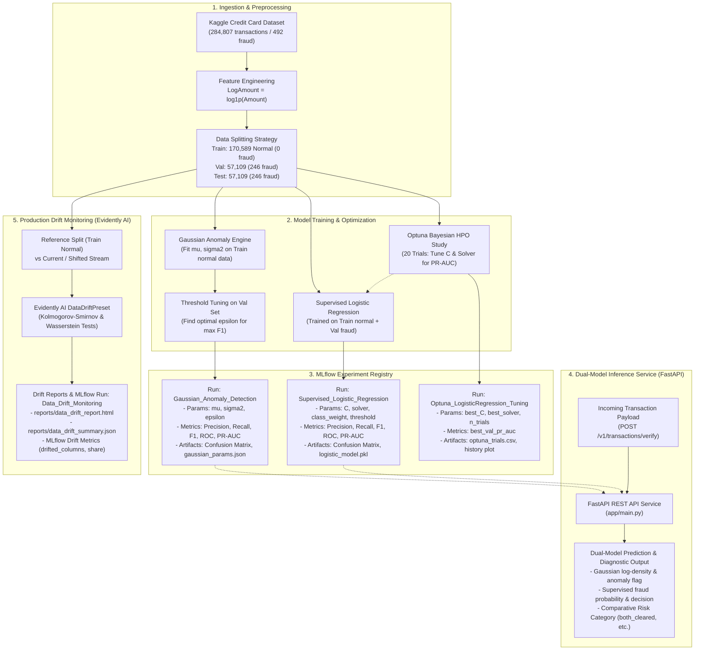

# Credit Card Fraud Anomaly Detection & Supervised Baseline Comparison API

[](https://www.python.org/)
[](https://fastapi.tiangolo.com/)
[](https://mlflow.org/)
[](https://optuna.org/)
[](https://www.evidentlyai.com/)
[](https://www.docker.com/)
[](https://docs.pytest.org/)
[](LICENSE)

A machine learning service and dual-model inference REST API comparing a **from-scratch Unsupervised Gaussian Anomaly Detection engine** against a **Supervised Logistic Regression baseline** on the [Kaggle Credit Card Fraud Detection dataset](https://www.kaggle.com/datasets/mlg-ulb/creditcardfraud), built around a production-style MLOps stack: experiment tracking, Bayesian hyperparameter tuning, containerized serving, and data drift monitoring.

This repository integrates an end-to-end modern **MLOps stack**:
- **Centralized Experiment Tracking (`MLflow`)**: Automated parameter logging, evaluation metrics (Precision, Recall, F1, ROC-AUC, PR-AUC), confusion matrices, and serialized model artifacts.
- **Bayesian Hyperparameter Tuning (`Optuna`)**: 20-trial Tree-structured Parzen Estimator (TPE) study optimizing regularization strength and solvers for maximum Precision-Recall Area Under the Curve (PR-AUC).
- **Production Data Drift Detection (`Evidently AI`)**: Automated statistical drift detection pipeline monitoring continuous features and transaction amount distribution shifts across inference batches.
- **Asynchronous Dual-Inference API (`FastAPI`)**: High-throughput microservice evaluating transactions against both models simultaneously with comparative risk diagnosis.
- **Containerization & CI/CD Verification (`Docker` & `pytest`)**: Production container definition with 18 automated unit and integration tests guaranteeing 100% test pass rate and backward compatibility.

---

## 📌 Business Problem & Dataset Context

Credit card fraud detection is characterized by **extreme class imbalance** and severe **asymmetric misclassification costs**:

- **Dataset Characteristics**:
  - Total Transactions: **284,807** European cardholder records over a two-day period.
  - Fraudulent Transactions: **492** confirmed fraudulent cases (**0.1727% fraud prevalence**; ratio of ~1 fraud per 578 normal transactions).
  - Feature Space: 28 principal components (`V1` to `V28`) obtained via PCA (for confidentiality), alongside transaction `Time` and raw `Amount`.
- **Why Raw Accuracy Fails**:
  - A naive "zero-intelligence" classifier that predicts every transaction is legitimate achieves **99.8273% raw accuracy**. However, it detects **0% of fraud**, resulting in catastrophic financial loss and regulatory liability.
- **The Asymmetry of Business Cost**:
  - **False Negatives (FN - Missed Fraud)**: Direct monetary theft, chargeback fees, loss of cardholder trust, and merchant dispute costs.
  - **False Positives (FP - False Alarm)**: Customer checkout friction, potential card abandonment, and manual security review queue overhead.
- **Why PR-AUC is the North-Star Metric**:
  - While standard ROC curves can present an overly optimistic picture under severe imbalance (because the true negative rate remains close to 1.0), the **Precision-Recall Curve (PR-AUC / Average Precision Score)** focuses strictly on the minority positive class. PR-AUC directly evaluates the trade-off between precision (minimizing false alarms) and recall (capturing fraud), making it the true gold-standard metric for fraud classification.

---

## 🏗️ End-to-End System Architecture

The following Mermaid diagram traces the end-to-end data lifecycle from raw Kaggle ingestion through model training, automated Bayesian tuning, MLflow experiment tracking, dual-model FastAPI inference, and Evidently AI drift monitoring.



---

## 📊 Comprehensive Model Benchmark

All models were evaluated on the **exact same held-out test split of 57,109 transactions (containing 246 fraud cases)** that was never seen during Gaussian parameter fitting or threshold tuning.

| Model / Pipeline Stage | Methodology | Decision Boundary | Precision | Recall | $F_1$-Score | PR-AUC | ROC-AUC |
| :--- | :--- | :--- | :---: | :---: | :---: | :---: | :---: |
| **Unsupervised Gaussian Anomaly Engine** | Product of Univariate Gaussians (Log-Space Summation) | $\epsilon = -219.939267$ | **33.84%** | **45.12%** | **0.3868** | **0.3222** | **0.9598** |
| **Supervised Baseline Logistic Regression** | `class_weight='balanced'`, $C=1.0$, `lbfgs` | Decision Threshold = $0.998999$ | **87.01%** | **81.71%** | **0.8428** | **0.8309** | **0.9737** |
| **Optuna-Tuned Logistic Regression** | `class_weight='balanced'`, $C=5.0324$, `liblinear` | Decision Threshold = $0.998999$ | **86.64%** | **81.71%** | **0.8410** | **0.8310** | **0.9737** |

### Key Technical Insights
1. **Unsupervised Density Signal**: The from-scratch Gaussian engine achieves an impressive **ROC-AUC of 0.9598** solely from statistical distribution properties of normal cardholder behavior, proving strong capability as a zero-day / novel fraud anomaly filter.
2. **Supervised Discrimination Power**: Because fraud involves specific multi-feature directional combinations rather than arbitrary extremity, supervised training with class-weight compensation achieves a significantly higher **$F_1$-Score of 0.8428** and **PR-AUC of 0.8309**.
3. **Dual-Model Production Value**: Combining both models in the inference engine provides multi-layered security: standard supervised models intercept known fraud patterns, while the Gaussian engine catches unexpected anomalous behavior outside nominal operational profiles.

---

## 🎯 Hyperparameter Optimization (Optuna)

Automated hyperparameter tuning is implemented in [`scripts/tune_hyperparameters.py`](file:///C:/Users/isaak/fraud-anomaly-detection/scripts/tune_hyperparameters.py).

### Study Configuration
- **Study Name**: `logistic-regression-tuning`
- **Optimization Direction**: `maximize`
- **Objective Metric**: Validation PR-AUC (Average Precision Score) on held-out validation fraud samples.
- **Sampler**: Tree-structured Parzen Estimator (`TPESampler(seed=42)`) over **20 trials**.
- **Search Space**:
  - `C`: Log-uniform continuous distribution from $10^{-4}$ to $10^{2}$ (`trial.suggest_float("C", 1e-4, 1e2, log=True)`)
  - `solver`: Categorical choice between `['lbfgs', 'liblinear']`

### Optimization Findings
- **Best Trial**: **Trial #14**
- **Optimal Regularization Strength ($C$)**: **`5.0324298172936786`**
- **Optimal Solver**: **`liblinear`**
- **Best Validation PR-AUC**: **`0.828653`**

### MLflow Integration
When executing `scripts/tune_hyperparameters.py`, an MLflow run named `Optuna_LogisticRegression_Tuning` is recorded under the `fraud-anomaly-detection` experiment containing:
- Parameter logs: `best_C`, `best_solver`, `n_trials=20`, `metric_optimized="PR-AUC"`.
- Metric logs: `best_val_pr_auc`, `best_trial_number`.
- Artifacts: Complete study trial history table (`optuna_study/optuna_trials.csv`) and convergence history visualization (`optuna_study/optimization_history.png`).

---

## 🧪 MLOps Experiment Tracking (MLflow)

All training runs, tuning iterations, and monitoring jobs are tracked locally under the unified MLflow experiment **`"fraud-anomaly-detection"`**.

### Experiment Runs & Logged Assets

| MLflow Run Name | Logged Parameters | Logged Metrics | Stored Artifacts |
| :--- | :--- | :--- | :--- |
| **`Gaussian_Anomaly_Detection`** | `model_type`, `scaling_method`, `threshold`, `epsilon`, `eps_numerical`, `distribution`, `val_tuning_steps` | `Precision`, `Recall`, `F1-score`, `ROC-AUC`, `PR-AUC` | `confusion_matrix.png`, `model/gaussian_params.json` |
| **`Supervised_Logistic_Regression`** | `model_type`, `scaling_method`, `threshold`, `max_iter`, `class_weight`, `solver`, `C` | `Precision`, `Recall`, `F1-score`, `ROC-AUC`, `PR-AUC` | `confusion_matrix.png`, `model/logistic_model.pkl`, Scikit-Learn model package |
| **`Optuna_LogisticRegression_Tuning`** | `study_name`, `n_trials`, `best_C`, `best_solver`, `metric_optimized` | `best_val_pr_auc`, `best_trial_number` | `optuna_study/optuna_trials.csv`, `optuna_study/optimization_history.png` |
| **`Data_Drift_Monitoring`** | `dataset_drift`, `clean_dataset_drift`, `total_columns` | `share_of_drifted_columns`, `number_of_drifted_columns`, `clean_share_of_drifted_columns` | `reports/data_drift_report.html`, `reports/data_drift_summary.json` |

### Launching the MLflow UI
To open the interactive MLflow web dashboard:

```bash
mlflow ui
```
Navigate to [http://localhost:5000](http://localhost:5000) or [http://127.0.0.1:5000](http://127.0.0.1:5000) in your web browser.

---

## 📈 Production Data Drift Monitoring (Evidently AI)

Real-world financial distributions shift due to macroeconomic changes, holiday shopping surges, and emerging adversarial fraud vectors. The drift detection engine in [`scripts/monitor_drift.py`](file:///C:/Users/isaak/fraud-anomaly-detection/scripts/monitor_drift.py) automates statistical quality control using Evidently AI.

### Drift Methodology
- **Reference Dataset**: 170,589 normal transactions from the baseline training distribution.
- **Statistical Tests Applied**:
  - **Kolmogorov-Smirnov (KS) Test** ($\alpha = 0.05$) on continuous PCA features (`V1` to `V28`) and `LogAmount`.
  - **Wasserstein Distance** for continuous distribution shift quantification.
- **Preset Configuration**: `evidently.metric_preset.DataDriftPreset` generating comprehensive `DatasetDriftMetric` and `DataDriftTable` reports.

### Drift Evaluation Results

```
================================================================================
                      DATA DRIFT MONITORING SUMMARY
================================================================================
 1. Clean Test Split Comparison:
    - Dataset Drift Flag: False
    - Drifted Columns:    0 / 29 (0.00% drift share)
    - Result:             Baseline distribution confirmed statistically stable.

 2. Shifted Transaction Batch Comparison (Perturbing Amount, V4, V11):
    - Dataset Drift Flag: False (below default 50% dataset drift threshold)
    - Drifted Columns:    3 / 29 (10.34% drift share)
    - Drifted Features:   V4 (KS p-val < 0.001), V11 (KS p-val < 0.001), LogAmount (KS p-val < 0.001)
    - Result:             Targeted feature perturbations successfully detected.
================================================================================
```

### Generated Artifacts
- **Interactive HTML Report**: [`reports/data_drift_report.html`](file:///C:/Users/isaak/fraud-anomaly-detection/reports/data_drift_report.html)
- **JSON Summary Metrics**: [`reports/data_drift_summary.json`](file:///C:/Users/isaak/fraud-anomaly-detection/reports/data_drift_summary.json)

---

## 🚀 Repository File Tree

```
fraud-anomaly-detection/
├── app/
│   ├── __init__.py
│   ├── schemas.py                 # Pydantic schemas (TransactionInput, VerificationResponse, etc.)
│   ├── anomaly_engine.py          # Log-density Gaussian Anomaly Engine (fit/tune/predict/save/load)
│   ├── baseline_model.py          # Supervised Logistic Regression model wrapper
│   └── main.py                    # FastAPI application, lifespan model loading, /health & /verify routes
├── data/
│   └── creditcard.csv             # Raw Kaggle credit card dataset (git-ignored)
├── models/
│   ├── gaussian_params.json       # Exported Gaussian parameters (mu, sigma2, epsilon, test metrics)
│   └── logistic_model.pkl         # Serialized Logistic Regression joblib artifact & decision threshold
├── notebooks/
│   └── 01_eda.ipynb               # Exploratory data analysis & statistical distribution checks
├── reports/
│   ├── data_drift_report.html     # Evidently AI standalone interactive HTML report
│   └── data_drift_summary.json    # Machine-readable JSON summary of clean and drifted metrics
├── scripts/
│   ├── train_and_export.py        # Model training pipeline with MLflow tracking & model serialization
│   ├── tune_hyperparameters.py    # Optuna 20-trial Bayesian hyperparameter optimization script
│   └── monitor_drift.py           # Evidently AI automated data drift detection pipeline
├── tests/
│   ├── __init__.py
│   ├── test_anomaly_engine.py     # Math exactness, synthetic fitting, vector scoring & serialization
│   ├── test_baseline_model.py     # Supervised probability ranges, transaction scoring & roundtrip IO
│   ├── test_drift.py              # Evidently drift pipeline unit test on synthetic DataFrames
│   ├── test_main.py               # FastAPI endpoint integration tests, payload validations, 422 errors
│   └── test_tuning.py             # Optuna objective & parameter output validation unit tests
├── .gitignore                     # Git ignore rules for venv, data, bytecode, and local MLflow DBs
├── Dockerfile                     # Python 3.11-slim production container definition
├── requirements.txt               # Pinned dependencies (FastAPI, Scikit-Learn, MLflow, Optuna, Evidently)
└── README.md                      # Comprehensive project documentation and operations runbook
```

---

## 📡 API Endpoints & Verification

### 1. `GET /health`
Returns service health status, model loading verification, and held-out test evaluation metrics.

```bash
curl -X GET "http://localhost:8000/health"
```

#### Example Health Response:
```json
{
  "status": "healthy",
  "gaussian_model_loaded": true,
  "supervised_model_loaded": true,
  "models_test_metrics": {
    "gaussian_anomaly_model": {
      "precision": 0.3384146341463415,
      "recall": 0.45121951219512196,
      "f1": 0.3867595818815331,
      "roc_auc": 0.9597851718629387,
      "pr_auc": 0.32219003793534656
    },
    "supervised_baseline_model": {
      "precision": 0.8701298701298701,
      "recall": 0.8170731707317073,
      "f1": 0.8427672955974843,
      "roc_auc": 0.973734510088361,
      "pr_auc": 0.8309109558100879
    }
  }
}
```

---

### 2. `POST /v1/transactions/verify`
Scores an incoming transaction against **both** the Gaussian Anomaly Engine and the Supervised Classifier simultaneously.

#### A. Normal Transaction Request:
```bash
curl -X POST "http://localhost:8000/v1/transactions/verify" \
     -H "Content-Type: application/json" \
     -d '{
       "V1": 0.448012, "V2": 2.035533, "V3": -0.608395, "V4": 4.684705,
       "V5": 1.296935, "V6": 0.211782, "V7": 0.763525, "V8": -0.036693,
       "V9": -1.621939, "V10": 1.435061, "V11": 1.131147, "V12": -0.965795,
       "V13": -0.791461, "V14": -2.463358, "V15": 0.065032, "V16": 0.892818,
       "V17": 1.871823, "V18": 1.494008, "V19": 1.176817, "V20": 0.464369,
       "V21": -0.473552, "V22": -0.962575, "V23": 0.082715, "V24": -0.728430,
       "V25": -0.700013, "V26": 0.032017, "V27": 0.244196, "V28": -0.094077,
       "Amount": 3.09
     }'
```

#### Normal Transaction Response:
```json
{
  "transaction_amount": 3.09,
  "log_amount": 1.408545,
  "gaussian_model": {
    "log_probability": -48.147945,
    "threshold": -219.939267,
    "is_anomaly": false
  },
  "supervised_model": {
    "fraud_probability": 0.708548,
    "threshold": 0.998999,
    "is_fraud": false
  },
  "comparison": {
    "status": "both_cleared",
    "message": "Low risk: Transaction aligns with normal Gaussian distributions and scored low fraud probability on the supervised model."
  }
}
```

---

#### B. Fraud Transaction Request:
```bash
curl -X POST "http://localhost:8000/v1/transactions/verify" \
     -H "Content-Type: application/json" \
     -d '{
       "V1": -18.018561, "V2": 10.558600, "V3": -24.667741, "V4": 11.786180,
       "V5": -10.564657, "V6": -2.645681, "V7": -18.023468, "V8": 2.693655,
       "V9": -6.219464, "V10": -12.744761, "V11": 9.318138, "V12": -13.377857,
       "V13": 1.021924, "V14": -12.784346, "V15": -0.451146, "V16": -7.551365,
       "V17": -11.325997, "V18": -4.701253, "V19": 0.516317, "V20": 1.007703,
       "V21": -2.319479, "V22": 0.908839, "V23": 1.352904, "V24": -1.059222,
       "V25": 0.185751, "V26": 0.687037, "V27": 2.078081, "V28": -1.429517,
       "Amount": 1.00
     }'
```

#### Fraud Transaction Response:
```json
{
  "transaction_amount": 1.0,
  "log_amount": 0.693147,
  "gaussian_model": {
    "log_probability": -963.049166,
    "threshold": -219.939267,
    "is_anomaly": true
  },
  "supervised_model": {
    "fraud_probability": 1.0,
    "threshold": 0.998999,
    "is_fraud": true
  },
  "comparison": {
    "status": "both_flagged",
    "message": "High risk: Both the statistical Gaussian anomaly engine (unsupervised density) and the supervised baseline flagged this transaction."
  }
}
```

---

## 🛠️ Quickstart Runbook

Follow these step-by-step instructions to set up the environment, run tests, train models, launch dashboards, and deploy the container.

### Step 1: Clone Repository & Set Up Virtual Environment

```bash
# Clone the repository
git clone https://github.com/IsaakAlemu/fraud-anomaly-detection.git
cd fraud-anomaly-detection

# Create a virtual environment
python -m venv venv

# Activate virtual environment
# Windows PowerShell:
.\venv\Scripts\Activate.ps1
# Linux / macOS:
source venv/bin/activate

# Upgrade pip and install all pinned dependencies
pip install -r requirements.txt
```

---

### Step 2: Execute Automated Test Suite

Run the full pytest suite across all unit, integration, and drift tests:

```bash
pytest -v tests
```

Expected output: `18 passed in ~7s`.

---

### Step 3: Run Model Training & MLflow Logging

Execute the complete training pipeline to train both models, calculate test metrics, create confusion matrix plots, and log runs to MLflow:

```bash
python scripts/train_and_export.py
```

---

### Step 4: Run Optuna Hyperparameter Optimization

Run the 20-trial Bayesian hyperparameter search to optimize regularization and solver parameters for PR-AUC:

```bash
python scripts/tune_hyperparameters.py
```

---

### Step 5: Run Evidently AI Data Drift Detection

Compute feature-level drift reports between baseline training data and test/shifted transaction batches:

```bash
python scripts/monitor_drift.py
```
Open `reports/data_drift_report.html` in your web browser to view the interactive dashboard.

---

### Step 6: Launch MLflow Tracking Server UI

Open the MLflow dashboard to view experiment runs, metrics, and artifact artifacts:

```bash
mlflow ui
```
Access at: [http://localhost:5000](http://localhost:5000)

---

### Step 7: Launch FastAPI Inference Service

Start the local development server:

```bash
uvicorn app.main:app --reload --host 0.0.0.0 --port 8000
```
- Interactive Swagger UI: [http://localhost:8000/docs](http://localhost:8000/docs)
- Interactive ReDoc: [http://localhost:8000/redoc](http://localhost:8000/redoc)

---

### Step 8: Build and Run with Docker

To build and run the production container:

```bash
# Build the Docker image
docker build -t fraud-anomaly-api .

# Run container on port 8000
docker run -d -p 8000:8000 --name fraud-api fraud-anomaly-api

# Check container health status
curl http://localhost:8000/health

# Stop and remove container
docker stop fraud-api && docker rm fraud-api
```

---

## Known Limitations

This project demonstrates a production-style MLOps workflow, not a deployed production system. Specifically:

- **No authentication or rate limiting** on the FastAPI endpoints — would be required before any real exposure.
- **Drift monitoring runs on offline batches**, not live inference traffic; a production deployment would need this wired into the actual request stream.
- **No retraining pipeline** — drift detection currently reports on distribution shift but doesn't trigger or automate model retraining.
- **No model registry/promotion workflow** — MLflow tracks experiments, but there's no staged promotion process (staging → production) or automated rollback.
- **Single historical dataset** — the 2013 European cardholder dataset is well-studied but static; real fraud patterns evolve, and this system hasn't been validated against a live or more recent distribution.

---

## 📜 License & Citation

- **License**: MIT License. See [LICENSE](LICENSE) for terms.
- **Dataset**: Machine Learning Group - ULB, [Credit Card Fraud Detection](https://www.kaggle.com/datasets/mlg-ulb/creditcardfraud).
- **Academic Reference**: Concepts inspired by the *Coursera Machine Learning Specialization* (Anomaly Detection formulation by Andrew Ng, Stanford University / DeepLearning.AI).
