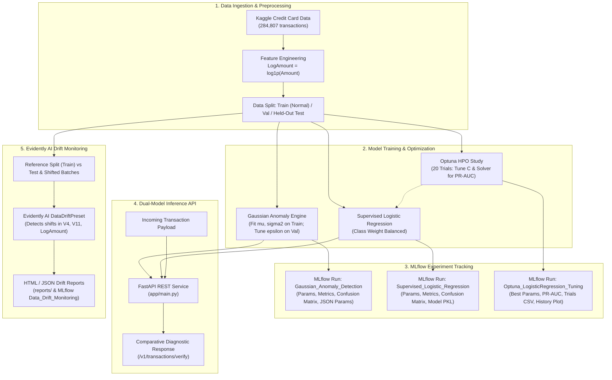

# Fraud Anomaly Detection & Supervised Baseline Comparison API (with MLOps Stack)

An enterprise-ready machine learning project and REST API comparing a **from-scratch Unsupervised Gaussian Anomaly Detection engine** against a **Supervised Logistic Regression baseline** on the [Kaggle Credit Card Fraud Detection dataset](https://www.kaggle.com/datasets/mlg-ulb/creditcardfraud).

This project integrates modern MLOps best practices:
- **MLflow**: Centralized experiment tracking, metric logging (Precision, Recall, F1, ROC-AUC, PR-AUC), confusion matrices, and serialized model artifacts.
- **Optuna**: Automated Bayesian hyperparameter optimization over regularization strength (`C`) and solvers (`lbfgs`, `liblinear`), maximizing validation PR-AUC.
- **Evidently AI**: Automated data drift detection pipeline comparing baseline training distributions against clean test splits and simulated production drift batches.
- **FastAPI**: Production-grade async inference service providing simultaneous dual-model evaluations and comparative risk diagnostics.
- **Docker**: Containerized deployment with full reproducibility and automated test verification.

---

## 🏗️ System Architecture



---

## 📊 Honest Empirical Findings & Model Comparison

> **Core Takeaway**: The from-scratch Gaussian anomaly model captures genuine tail-distribution anomaly signal ($F_1 = 0.3868$, $\text{ROC-AUC} = 0.9598$), but the supervised baseline with balanced class weights is dramatically stronger ($F_1 = 0.8428$, $\text{PR-AUC} = 0.8309$). The dual-model design leverages both: statistical density estimates catch novel zero-day distribution shifts, while supervised decision boundaries detect known fraud signatures.

### Test Set Performance Comparison (57,109 Held-Out Transactions, 246 Fraud Cases)

| Model | Approach | Tuned Decision Boundary | Precision | Recall | $F_1$-Score | PR-AUC | ROC-AUC |
| :--- | :--- | :--- | :---: | :---: | :---: | :---: | :---: |
| **Gaussian Anomaly Engine** | Unsupervised density estimation (product of 1D Gaussians) | $\epsilon = -219.939267$ | **33.84%** | **45.12%** | **0.3868** | **0.3222** | **0.9598** |
| **Supervised Baseline** | Logistic Regression (`class_weight='balanced'`) | Probability threshold = $0.998999$ | **87.01%** | **81.71%** | **0.8428** | **0.8309** | **0.9737** |

*All metrics are automatically logged to the `fraud-anomaly-detection` MLflow experiment.*

---

## 🎯 Hyperparameter Optimization with Optuna

Automated hyperparameter tuning in `scripts/tune_hyperparameters.py` conducts a 20-trial study using Tree-structured Parzen Estimator (TPE) sampling to maximize validation **PR-AUC**:

- **Search Space**:
  - `C`: Log-uniform scale from $10^{-4}$ to $10^2$ ($0.0001 \le C \le 100.0$)
  - `solver`: Categorical choices `['lbfgs', 'liblinear']`
- **Study Results**:
  - **Best Trial**: `#14`
  - **Best Validation PR-AUC**: **`0.828653`**
  - **Optimal `C`**: **`5.032430`**
  - **Optimal `solver`**: **`liblinear`**
- **MLflow Tracking**: Logs the best parameter set, trial progression history plot (`optuna_study/optimization_history.png`), and complete trials summary table (`optuna_study/optuna_trials.csv`).

---

## 📈 Production Data Drift Monitoring with Evidently AI

Real-world financial transaction distributions evolve over time. The drift detection pipeline in `scripts/monitor_drift.py` utilizes Evidently AI's `DataDriftPreset` to compare baseline distributions against current transaction streams:

1. **Clean Test Split vs. Reference**: Confirms statistical stability ($0/29$ drifted columns, **$0.00\%$ drift**).
2. **Simulated Shifted Batch vs. Reference**: Injects real-world behavioral changes (scaling transaction amounts and shifting PCA components `V4` and `V11`). The pipeline successfully isolates and flags drift on all 3 target features (**$10.34\%$ column drift**).
3. **Artifacts Generated**:
   - Interactive HTML visualization report: `reports/data_drift_report.html`
   - Structured JSON summary: `reports/data_drift_summary.json`
   - Persistent logging to MLflow under the `Data_Drift_Monitoring` run.

---

## 🚀 Repository Structure

```
fraud-anomaly-detection/
├── app/
│   ├── __init__.py
│   ├── schemas.py                 # Pydantic validation & response schemas
│   ├── anomaly_engine.py          # Independent Gaussian density engine
│   ├── baseline_model.py          # Supervised Logistic Regression wrapper
│   └── main.py                    # FastAPI service (/health, /v1/transactions/verify)
├── data/
│   └── creditcard.csv             # Kaggle dataset (git-ignored)
├── models/
│   ├── gaussian_params.json       # Serialized mu, sigma2, epsilon, and metrics
│   └── logistic_model.pkl         # Serialized Logistic Regression artifact & threshold
├── notebooks/
│   └── 01_eda.ipynb               # Exploratory data analysis notebook
├── reports/
│   ├── data_drift_report.html     # Interactive Evidently AI HTML report
│   └── data_drift_summary.json    # JSON summary of clean & shifted drift metrics
├── scripts/
│   ├── train_and_export.py        # Model training, evaluation & MLflow logging
│   ├── tune_hyperparameters.py    # Optuna 20-trial hyperparameter optimization
│   └── monitor_drift.py           # Evidently AI data drift detection pipeline
├── tests/
│   ├── __init__.py
│   ├── test_anomaly_engine.py     # Gaussian math verification, fitting & scoring
│   ├── test_baseline_model.py     # Supervised prediction & probability tests
│   ├── test_drift.py              # Evidently drift pipeline unit tests
│   ├── test_main.py               # FastAPI integration & validation tests
│   └── test_tuning.py             # Optuna objective & parameter output tests
├── .gitignore
├── Dockerfile                     # Python 3.11-slim container definition
├── requirements.txt               # Pinned project dependencies
└── README.md                      # Comprehensive project documentation
```

---

## 🛠️ Quickstart Commands

### 1. Environment Setup

```bash
# Clone the repository
git clone https://github.com/IsaakAlemu/fraud-anomaly-detection.git
cd fraud-anomaly-detection

# Create and activate virtual environment
python -m venv venv

# On Windows PowerShell:
.\venv\Scripts\Activate.ps1
# On Linux / macOS:
source venv/bin/activate

# Install dependencies
pip install -r requirements.txt
```

### 2. Model Training & MLflow Logging

Train both Gaussian and Supervised models, evaluate metrics, generate confusion matrices, and log runs to MLflow:

```bash
python scripts/train_and_export.py
```

### 3. Launch MLflow Tracking UI

Explore experiment runs, metric comparisons, confusion matrix plots, and model artifacts in your browser:

```bash
mlflow ui
```
Open [http://localhost:5000](http://localhost:5000) or [http://127.0.0.1:5000](http://127.0.0.1:5000).

### 4. Run Optuna Hyperparameter Optimization

Execute the 20-trial Bayesian optimization study:

```bash
python scripts/tune_hyperparameters.py
```

### 5. Run Evidently AI Data Drift Monitoring

Generate interactive HTML and JSON data drift reports and log them to MLflow:

```bash
python scripts/monitor_drift.py
```

### 6. Run Test Suite

Execute all 18 automated unit and integration tests:

```bash
pytest -v tests
```

### 7. Launch FastAPI Inference Server

```bash
uvicorn app.main:app --reload --host 0.0.0.0 --port 8000
```
Interactive Swagger documentation: [http://localhost:8000/docs](http://localhost:8000/docs).

---

## 📡 API Reference & Mock Requests

### `POST /v1/transactions/verify`
Scores an incoming transaction against **both** models simultaneously.

#### Example Request: Normal Transaction

```bash
curl -X POST "http://localhost:8000/v1/transactions/verify" \
     -H "Content-Type: application/json" \
     -d '{
       "V1": 0.448012, "V2": 2.035533, "V3": -0.608395, "V4": 4.684705,
       "V5": 1.296935, "V6": 0.211782, "V7": 0.763525, "V8": -0.036693,
       "V9": -1.621939, "V10": 1.435061, "V11": 1.131147, "V12": -0.965795,
       "V13": -0.791461, "V14": -2.463358, "V15": 0.065032, "V16": 0.892818,
       "V17": 1.871823, "V18": 1.494008, "V19": 1.176817, "V20": 0.464369,
       "V21": -0.473552, "V22": -0.962575, "V23": 0.082715, "V24": -0.728430,
       "V25": -0.700013, "V26": 0.032017, "V27": 0.244196, "V28": -0.094077,
       "Amount": 3.09
     }'
```

#### Example Response: Normal Transaction

```json
{
  "transaction_amount": 3.09,
  "log_amount": 1.408545,
  "gaussian_model": {
    "log_probability": -48.147945,
    "threshold": -219.939267,
    "is_anomaly": false,
    "model_type": "Unsupervised Gaussian (from-scratch density estimation)"
  },
  "supervised_model": {
    "fraud_probability": 0.708548,
    "threshold": 0.998999,
    "is_fraud": false,
    "model_type": "Supervised Logistic Regression (balanced class weights)"
  },
  "comparison": {
    "status": "both_cleared",
    "message": "Low risk: Transaction aligns with normal Gaussian distributions and scored low fraud probability on the supervised model."
  }
}
```

---

#### Example Request: Fraud Transaction

```bash
curl -X POST "http://localhost:8000/v1/transactions/verify" \
     -H "Content-Type: application/json" \
     -d '{
       "V1": -18.018561, "V2": 10.558600, "V3": -24.667741, "V4": 11.786180,
       "V5": -10.564657, "V6": -2.645681, "V7": -18.023468, "V8": 2.693655,
       "V9": -6.219464, "V10": -12.744761, "V11": 9.318138, "V12": -13.377857,
       "V13": 1.021924, "V14": -12.784346, "V15": -0.451146, "V16": -7.551365,
       "V17": -11.325997, "V18": -4.701253, "V19": 0.516317, "V20": 1.007703,
       "V21": -2.319479, "V22": 0.908839, "V23": 1.352904, "V24": -1.059222,
       "V25": 0.185751, "V26": 0.687037, "V27": 2.078081, "V28": -1.429517,
       "Amount": 1.00
     }'
```

#### Example Response: Fraud Transaction

```json
{
  "transaction_amount": 1.0,
  "log_amount": 0.693147,
  "gaussian_model": {
    "log_probability": -963.049166,
    "threshold": -219.939267,
    "is_anomaly": true,
    "model_type": "Unsupervised Gaussian (from-scratch density estimation)"
  },
  "supervised_model": {
    "fraud_probability": 1.0,
    "threshold": 0.998999,
    "is_fraud": true,
    "model_type": "Supervised Logistic Regression (balanced class weights)"
  },
  "comparison": {
    "status": "both_flagged",
    "message": "High risk: Both the statistical Gaussian anomaly engine (unsupervised density) and the supervised baseline flagged this transaction."
  }
}
```

---

## 🐳 Docker Deployment

Build and run the service within a lightweight container:

```bash
# Build Docker image
docker build -t fraud-anomaly-api .

# Run container on port 8000
docker run -d -p 8000:8000 --name fraud-api fraud-anomaly-api

# Check health
curl http://localhost:8000/health
```

---

## 📜 License & Acknowledgments

- Built upon concepts from the **Coursera Machine Learning Specialization (Unsupervised Learning, Recommenders, Reinforcement Learning by Andrew Ng)**.
- Dataset provided by **Machine Learning Group - ULB** on Kaggle.
